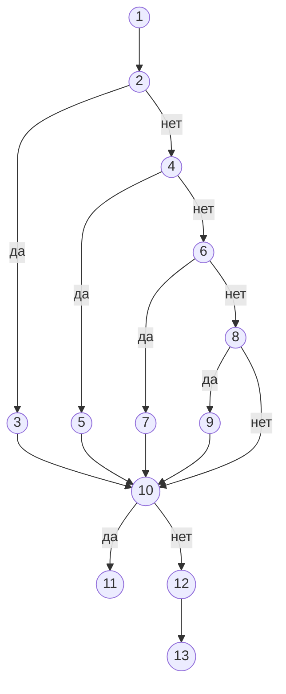

# Практическая работа №12. Тестирование баз данных

## Цель работы

1. Практически протестировать программы, работающие с базой данных, методами белого ящика, основанными на потоке данных.
2. Протестировать работу с базой данных на защищённость от SQL-инъекций.

## Теоретические сведения

### Тестирование работы с базой данных

Тестирование работы с базой данных (БД) — проверка функциональных возможностей программы, которые пользователь явно не видит. Пользователь может не знать, что система использует БД, например при поиске в каталоге. При этом данные, которые он вводит, становятся частью БД.

Тестирование БД выполняется на двух уровнях:

- **административных функций** — создание и изменение структуры, права доступа, резервное копирование;
- **пользовательских функций** — добавление, изменение, удаление и выборка данных через программу.

Для тестирования программ, работающих с БД, нужно хорошо знать тестируемое приложение и структуру базы. Поэтому применяются методы **белого ящика**, основанные на потоке данных.

### Инструменты

Для работы с **MySQL** используется **MySQL Workbench** или **phpMyAdmin**. В них можно выполнять SQL-запросы, просматривать содержимое таблиц и анализировать выполнение запроса командой `EXPLAIN`. Автоматические тесты пишутся на JavaScript с **Jest** и драйвером **mysql2**.

### Советы по тестированию БД

1. **Написание SQL-запросов.** Тестировщик должен знать SQL и внутреннюю структуру БД. Если приложение сложное и написать все запросы самостоятельно трудно, следует обратиться к разработчику.
2. **Помощь разработчика.** Тестировщик выполняет операции через графический интерфейс и проверяет результат SQL-запросами, написанными разработчиком. Это повышает качество тестирования и мастерство разработчика в написании запросов. Но если запрос разработчика семантически неверен, то есть неправильно проверяет требования пользователя, тестирование не гарантирует качества продукта. Поэтому лучший подход — совместная работа тестировщика, нацеленного на проверку требований пользователя, и разработчика.
3. **Просмотр данных в таблицах.** Если тестировщик не знает SQL, он может проверить результат операции, просматривая таблицы БД в графическом интерфейсе. Этот способ требует хорошего знания структуры таблиц и становится громоздким, когда таблиц много, они большого объёма, а данные распределены по нескольким таблицам.

### Тестирование потока данных

**Тестирование потока данных** — семейство стратегий, связанных с состоянием переменных или объектов данных. Оно исследует пути, на которых переменные получают значения (**определение**, def) и на которых эти значения используются (**использование**, use). Это те же покрытия, что и в практической работе №9, но с фокусом на значения данных.

Использование бывает двух видов:

- **вычислительное** (c-use) — значение участвует в вычислении или передаётся в функцию;
- **предикатное** (p-use) — значение участвует в условии.

Тестирование потока данных помогает выявить проблемы:

- переменная объявлена, но не используется;
- переменная используется, но не объявлена;
- переменная определяется несколько раз до использования;
- переменная удаляется или теряет значение до использования.

Стратегии тестирования на основе потока данных:

- **тестирование всех взаимосвязей «определение — использование»** — покрываются все пары, в которых переменная определяется и затем используется, то есть все дуги информационного графа программы. Недостаток: стратегия не гарантирует покрытие решений;
- **стратегия требуемых пар** — тестируются пары «вершина — дуга». Использование переменной в условии дублируется по числу выходов решения, и каждая такая взаимосвязь тестируется. Определение переменной находится в вершине управляющего графа, использование — на дугах, выходящих из решений, и в вычислительных вершинах.

### Операции реляционной алгебры в SQL

| Операция | Описание | Оператор SQL |
| --- | --- | --- |
| **Выборка уникальных значений** | Удаляет повторяющиеся значения | `SELECT DISTINCT` |
| **Разность** | Элементы первого набора, которых нет во втором | `EXCEPT` |
| **Пересечение** | Элементы, которые есть в обоих наборах | `INTERSECT` |
| **Объединение** | Уникальные элементы, которые есть хотя бы в одном наборе | `UNION` |

Операторы `INTERSECT` и `EXCEPT` поддерживаются в MySQL начиная с версии 8.0.31. Проверить версию сервера можно запросом `SELECT VERSION();`. В более старых версиях вместо них используются подзапросы `IN` и `NOT IN`, примеры приведены в разделе «Примеры».

`UNION` удаляет повторы из результата, `UNION ALL` оставляет все строки.

Без `ORDER BY` порядок строк в результате запроса не гарантирован. Если тест сравнивает результат с упорядоченным списком, запрос должен содержать `ORDER BY`.

### SQL-инъекции

**SQL-инъекция** — атака, при которой злоумышленник вводит в поле программы фрагмент SQL-кода, и этот фрагмент выполняется как часть запроса. Уязвимость возникает, когда программа собирает запрос, подставляя введённое значение прямо в текст запроса. Инъекции входят в список **OWASP Top 10:2025** (категория A05 Injection).

Пример уязвимого запроса:

```js
db.query(`SELECT name, type FROM planets WHERE name = '${name}'`);
```

Если пользователь введёт `' OR '1'='1`, запрос примет вид:

```sql
SELECT name, type FROM planets WHERE name = '' OR '1'='1'
```

Условие истинно для всех строк, и запрос вернёт всю таблицу.

Типовые проверки на SQL-инъекции:

| Ввод | Цель атаки | Признак уязвимости |
| --- | --- | --- |
| `'` | Нарушить синтаксис запроса | Ошибка SQL вместо пустого результата |
| `' OR '1'='1` | Сделать условие всегда истинным | Возвращаются все записи |
| `' UNION SELECT login, password FROM accounts -- ` | Прочитать данные другой таблицы | В результате появляются чужие данные |
| `'; DROP TABLE planets; -- ` | Выполнить вторую команду | Таблица удалена или изменена |

Основной способ защиты — **параметризованный запрос**: значение передаётся отдельно от текста запроса, на его место в тексте ставится знак `?`. Драйвер передаёт значение как данные, и оно не может изменить структуру запроса.

```js
db.query('SELECT name, type FROM planets WHERE name = ?', [name]);
```

Дополнительные меры: пользователь БД, от имени которого работает программа, получает только необходимые права; вводимые данные проверяются по формату.

## Задания

### Задание 1. Тестирование операций реляционной алгебры

1. Выполните в MySQL Workbench или phpMyAdmin примеры 1–5 из раздела «Примеры» и сравните результаты с приведёнными.
2. Самостоятельно постройте программы для операций реляционной алгебры (выборка уникальных значений, разность, пересечение, объединение) на таблицах своей предметной области. Образец — пример 6.
3. Выполните тестирование изученными методами белого ящика, основываясь на потоке данных.
4. Постройте **граф покрытия путей**.
5. Для одной из программ составьте **таблицу тестирования** с указанием покрытия путей:

| № теста | Путь | Ожидаемый результат | Полученный результат | Вывод о полноте покрытия с указанием путей |
| --- | --- | --- | --- | --- |
| 1 | | | | |
| 2 | | | | |

### Задание 2. Тестирование на SQL-инъекции

1. Добавьте в свою программу функцию поиска записи по значению, которое вводит пользователь, в двух версиях: с подстановкой значения в текст запроса и с параметризованным запросом. Образец — пример 7.
2. Напишите тесты с типовыми проверками на SQL-инъекции из раздела «Теоретические сведения».
3. Запустите тесты для обеих версий и объясните результаты.
4. Сделайте вывод о защищённости каждой версии.

### Задание 3. Отчёт

Отчёт по работе должен включать:

- тексты программ;
- граф покрытия путей;
- пары «определение — использование» для переменных программы;
- таблицу тестирования;
- результаты тестирования на SQL-инъекции.

## Примеры

В примерах используются MySQL 8, JavaScript, Node.js, **Jest** и драйвер **mysql2**. Установка Jest описана в практической работе №5, установка mysql2 и подключение к БД — в практической работе №11.

### Пример 1. База данных

В примерах используется база `solarsystem` с планетами Солнечной системы. Тип планеты: `Rock` (каменная), `Gas` (газовая), `Liquid` (жидкая), `Ice` (ледяная). Выполните скрипт `db.sql`:

```sql
CREATE DATABASE IF NOT EXISTS solarsystem;
USE solarsystem;

CREATE TABLE planets (
  name VARCHAR(20) PRIMARY KEY,
  type VARCHAR(10) NOT NULL,
  order_from_sun INT NOT NULL
);

INSERT INTO planets (name, type, order_from_sun) VALUES
  ('Mercury', 'Rock', 1),
  ('Venus', 'Rock', 2),
  ('Earth', 'Rock', 3),
  ('Mars', 'Rock', 4),
  ('Jupiter', 'Gas', 5),
  ('Saturn', 'Gas', 6),
  ('Uranus', 'Liquid', 7),
  ('Neptune', 'Liquid', 8),
  ('Pluto', 'Ice', 9);

CREATE TABLE names_dup (name VARCHAR(20) NOT NULL);
INSERT INTO names_dup (name) VALUES
  ('Mercury'), ('Venus'), ('Venus'), ('Earth'), ('Mars'), ('Earth');

CREATE TABLE names1 (name VARCHAR(20) NOT NULL);
INSERT INTO names1 (name) VALUES ('Mercury'), ('Venus'), ('Earth'), ('Jupiter');

CREATE TABLE names2 (name VARCHAR(20) NOT NULL);
INSERT INTO names2 (name) VALUES ('Mercury'), ('Earth'), ('Mars'), ('Jupiter');

CREATE TABLE accounts (
  login VARCHAR(20) PRIMARY KEY,
  password VARCHAR(50) NOT NULL
);
INSERT INTO accounts (login, password) VALUES ('admin', 'Qwerty123'), ('manager', 'Summer2026');
```

Таблица `accounts` нужна для примера 7: она показывает, какие данные может получить злоумышленник через инъекцию.

### Пример 2. Выборка уникальных значений: DISTINCT

Запрос возвращает уникальные значения из таблицы с повторами:

```sql
SELECT DISTINCT name FROM names_dup;
```

Результат:

```text
Mercury
Venus
Earth
Mars
```

Выборка по ключу: первая планета каждого типа (по порядку от Солнца).

```sql
SELECT p.name, p.type, p.order_from_sun
FROM planets p
WHERE p.order_from_sun = (
  SELECT MIN(order_from_sun) FROM planets WHERE type = p.type
)
ORDER BY p.order_from_sun;
```

Результат:

```text
Mercury  Rock    1
Jupiter  Gas     5
Uranus   Liquid  7
Pluto    Ice     9
```

### Пример 3. Разность: EXCEPT

Запрос возвращает элементы из `names1`, которых нет в `names2`:

```sql
SELECT name FROM names1 EXCEPT SELECT name FROM names2;
```

Результат:

```text
Venus
```

Разность по ключу: полные записи планет, имена которых есть в `names1`, но отсутствуют в `names2`.

```sql
SELECT name, type, order_from_sun
FROM planets
WHERE name IN (SELECT name FROM names1 EXCEPT SELECT name FROM names2);
```

Результат:

```text
Venus  Rock  2
```

Для MySQL старше 8.0.31:

```sql
SELECT name FROM names1 WHERE name NOT IN (SELECT name FROM names2);
```

### Пример 4. Пересечение: INTERSECT

Запрос возвращает элементы, которые есть в обеих таблицах:

```sql
SELECT name FROM names1 INTERSECT SELECT name FROM names2;
```

Результат:

```text
Mercury
Earth
Jupiter
```

Пересечение записей: первые пять планет от Солнца и последние пять планет (без Плутона).

```sql
SELECT * FROM planets WHERE order_from_sun BETWEEN 1 AND 5
INTERSECT
SELECT * FROM planets WHERE order_from_sun BETWEEN 4 AND 8
ORDER BY order_from_sun;
```

Результат:

```text
Mars     Rock  4
Jupiter  Gas   5
```

Для MySQL старше 8.0.31:

```sql
SELECT name FROM names1 WHERE name IN (SELECT name FROM names2);
```

### Пример 5. Объединение: UNION

Запрос возвращает уникальные элементы из обеих таблиц:

```sql
SELECT name FROM names1 UNION SELECT name FROM names2;
```

Результат:

```text
Mercury
Venus
Earth
Jupiter
Mars
```

Объединение записей тех же двух наборов планет:

```sql
SELECT * FROM planets WHERE order_from_sun BETWEEN 1 AND 5
UNION
SELECT * FROM planets WHERE order_from_sun BETWEEN 4 AND 8
ORDER BY order_from_sun;
```

Результат:

```text
Mercury  Rock    1
Venus    Rock    2
Earth    Rock    3
Mars     Rock    4
Jupiter  Gas     5
Saturn   Gas     6
Uranus   Liquid  7
Neptune  Liquid  8
```

Марс и Юпитер входят в оба набора, но в результат попадают один раз.

### Пример 6. Программа и тестирование потока данных

#### А. Подключение к БД

Файл `db.js`:

```js
const mysql = require('mysql2/promise');

const pool = mysql.createPool({
  host: process.env.DB_HOST || 'localhost',
  user: process.env.DB_USER || 'root',
  password: process.env.DB_PASSWORD || '',
  database: process.env.DB_NAME || 'solarsystem',
});

module.exports = pool;
```

#### Б. Программа

Файл `set-operations.js`. Функция получает название операции, выбирает запрос и возвращает имена из результата. Номера вершин графа указаны в комментариях.

```js
async function setOperation(db, operation) {
  let sql;                                                              // 1
  if (operation === 'distinct') {                                       // 2
    sql = 'SELECT DISTINCT name FROM names_dup';                        // 3
  } else if (operation === 'union') {                                   // 4
    sql = 'SELECT name FROM names1 UNION SELECT name FROM names2';      // 5
  } else if (operation === 'intersect') {                               // 6
    sql = 'SELECT name FROM names1 INTERSECT SELECT name FROM names2';  // 7
  } else if (operation === 'except') {                                  // 8
    sql = 'SELECT name FROM names1 EXCEPT SELECT name FROM names2';     // 9
  }
  if (sql === undefined) {                                              // 10
    throw new Error(`Неизвестная операция: ${operation}`);              // 11
  }
  const [rows] = await db.query(sql + ' ORDER BY name');                // 12
  return rows.map((row) => row.name);                                   // 13
}

module.exports = { setOperation };
```

#### В. Граф покрытия путей



Пути:

- путь 1: 1-2-3-10-12-13;
- путь 2: 1-2-4-5-10-12-13;
- путь 3: 1-2-4-6-7-10-12-13;
- путь 4: 1-2-4-6-8-9-10-12-13;
- путь 5: 1-2-4-6-8-10-11.

#### Г. Пары «определение — использование»

| Переменная | Определение | Использование | Вид использования | Путь |
| --- | --- | --- | --- | --- |
| `operation` | 1 (параметр) | 2, 4, 6, 8 | p-use | 1–5 |
| `operation` | 1 (параметр) | 11 | c-use | 5 |
| `sql` | 1 (значение `undefined`) | 10, дуга «да» | p-use | 5 |
| `sql` | 3 | 10, дуга «нет»; 12 | p-use, c-use | 1 |
| `sql` | 5 | 10, дуга «нет»; 12 | p-use, c-use | 2 |
| `sql` | 7 | 10, дуга «нет»; 12 | p-use, c-use | 3 |
| `sql` | 9 | 10, дуга «нет»; 12 | p-use, c-use | 4 |
| `rows` | 12 | 13 | c-use | 1–4 |

Пять путей покрывают все пары «определение — использование» и оба выхода решения в вершине 10, то есть выполняются обе стратегии: всех взаимосвязей и требуемых пар.

#### Д. Тесты

Файл `tests/set-operations.test.js`. Ожидаемые результаты упорядочены по имени, так как в запросе есть `ORDER BY name`.

```js
const db = require('../db');
const { setOperation } = require('../set-operations');

afterAll(async () => {
  await db.end();
});

describe('setOperation: покрытие пар «определение — использование» переменной sql', () => {
  test('путь 1: distinct удаляет повторы', async () => {
    expect(await setOperation(db, 'distinct')).toEqual(['Earth', 'Mars', 'Mercury', 'Venus']);
  });

  test('путь 2: union объединяет без повторов', async () => {
    expect(await setOperation(db, 'union'))
      .toEqual(['Earth', 'Jupiter', 'Mars', 'Mercury', 'Venus']);
  });

  test('путь 3: intersect возвращает общие элементы', async () => {
    expect(await setOperation(db, 'intersect')).toEqual(['Earth', 'Jupiter', 'Mercury']);
  });

  test('путь 4: except возвращает разность', async () => {
    expect(await setOperation(db, 'except')).toEqual(['Venus']);
  });

  test('путь 5: неизвестная операция — исключение', async () => {
    await expect(setOperation(db, 'join')).rejects.toThrow('Неизвестная операция: join');
  });
});
```

Запуск:

```bash
npx jest --verbose tests/set-operations.test.js
```

Результат:

```text
PASS tests/set-operations.test.js
  setOperation: покрытие пар «определение — использование» переменной sql
    ✓ путь 1: distinct удаляет повторы (30 ms)
    ✓ путь 2: union объединяет без повторов (2 ms)
    ✓ путь 3: intersect возвращает общие элементы (2 ms)
    ✓ путь 4: except возвращает разность (1 ms)
    ✓ путь 5: неизвестная операция — исключение (3 ms)

Test Suites: 1 passed, 1 total
Tests:       5 passed, 5 total
```

#### Е. Таблица тестирования

| № теста | Путь | Ожидаемый результат | Полученный результат | Вывод о полноте покрытия с указанием путей |
| --- | --- | --- | --- | --- |
| 1 | 1-2-3-10-12-13 | Earth, Mars, Mercury, Venus | Earth, Mars, Mercury, Venus | Покрыта пара `sql` (3; 10, 12) |
| 2 | 1-2-4-5-10-12-13 | Earth, Jupiter, Mars, Mercury, Venus | Earth, Jupiter, Mars, Mercury, Venus | Покрыта пара `sql` (5; 10, 12) |
| 3 | 1-2-4-6-7-10-12-13 | Earth, Jupiter, Mercury | Earth, Jupiter, Mercury | Покрыта пара `sql` (7; 10, 12) |
| 4 | 1-2-4-6-8-9-10-12-13 | Venus | Venus | Покрыта пара `sql` (9; 10, 12) |
| 5 | 1-2-4-6-8-10-11 | Исключение «Неизвестная операция: join» | Исключение «Неизвестная операция: join» | Покрыта пара `sql` (1; 10, дуга «да»). Все пары и пути 1–5 покрыты |

### Пример 7. Тестирование на SQL-инъекции

#### А. Две версии функции поиска

Файл `planet-search.js`:

```js
// Уязвимая версия: значение подставляется в текст запроса
async function findPlanetsUnsafe(db, name) {
  const [rows] = await db.query(`SELECT name, type FROM planets WHERE name = '${name}'`);
  return rows;
}

// Безопасная версия: параметризованный запрос
async function findPlanets(db, name) {
  const [rows] = await db.query('SELECT name, type FROM planets WHERE name = ?', [name]);
  return rows;
}

module.exports = { findPlanetsUnsafe, findPlanets };
```

#### Б. Тесты

Файл `tests/planet-search.test.js`. Один набор тестов запускается для обеих версий с помощью `describe.each`.

```js
const db = require('../db');
const { findPlanetsUnsafe, findPlanets } = require('../planet-search');

afterAll(async () => {
  await db.end();
});

describe.each([
  ['findPlanetsUnsafe', findPlanetsUnsafe],
  ['findPlanets', findPlanets],
])('%s', (title, find) => {
  test('находит планету по точному имени', async () => {
    expect(await find(db, 'Mars')).toEqual([{ name: 'Mars', type: 'Rock' }]);
  });

  test('не находит несуществующую планету', async () => {
    expect(await find(db, 'Vulcan')).toEqual([]);
  });

  test("инъекция ' OR '1'='1 не возвращает все записи", async () => {
    expect(await find(db, "' OR '1'='1")).toEqual([]);
  });

  test('инъекция с UNION не раскрывает данные другой таблицы', async () => {
    expect(await find(db, "' UNION SELECT login, password FROM accounts -- ")).toEqual([]);
  });

  test('инъекция с DROP TABLE не выполняется', async () => {
    await find(db, "'; DROP TABLE planets; -- ").catch(() => {});
    const [rows] = await db.query('SELECT COUNT(*) AS count FROM planets');
    expect(rows[0].count).toBe(9);
  });
});
```

#### В. Результат

Запуск:

```bash
npx jest --verbose tests/planet-search.test.js
```

Результат (фрагмент, подробный вывод первого упавшего теста опущен):

```text
FAIL tests/planet-search.test.js
  findPlanetsUnsafe
    ✓ находит планету по точному имени (47 ms)
    ✓ не находит несуществующую планету (2 ms)
    ✕ инъекция ' OR '1'='1 не возвращает все записи (8 ms)
    ✕ инъекция с UNION не раскрывает данные другой таблицы (3 ms)
    ✓ инъекция с DROP TABLE не выполняется (6 ms)
  findPlanets
    ✓ находит планету по точному имени (2 ms)
    ✓ не находит несуществующую планету (1 ms)
    ✓ инъекция ' OR '1'='1 не возвращает все записи (1 ms)
    ✓ инъекция с UNION не раскрывает данные другой таблицы (7 ms)
    ✓ инъекция с DROP TABLE не выполняется (2 ms)

  ● findPlanetsUnsafe › инъекция с UNION не раскрывает данные другой таблицы

    expect(received).toEqual(expected) // deep equality

    - Expected  -  1
    + Received  + 10

    - Array []
    + Array [
    +   Object {
    +     "name": "admin",
    +     "type": "Qwerty123",
    +   },
    +   Object {
    +     "name": "manager",
    +     "type": "Summer2026",
    +   },
    + ]

Tests:       2 failed, 8 passed, 10 total
```

Разбор результата:

- обе версии правильно работают на обычных данных, поэтому без проверок на инъекции уязвимость не видна;
- в уязвимой версии инъекция `' OR '1'='1` вернула все 9 планет, а инъекция с `UNION` — логины и пароли из таблицы `accounts`;
- инъекция с `DROP TABLE` не сработала: драйвер mysql2 по умолчанию запрещает выполнять несколько команд в одном запросе и возвращает ошибку синтаксиса. Если включить параметр `multipleStatements: true`, таблица будет удалена. Уязвимость при этом остаётся: первые две инъекции её доказывают;
- параметризованная версия прошла все тесты: введённая строка передаётся как значение и не меняет запрос.

## Контрольные вопросы

1. На каких двух уровнях выполняется тестирование БД?
2. Почему тестирование программ, работающих с БД, выполняется методами белого ящика?
3. Какие проблемы позволяет выявить тестирование потока данных?
4. Чем стратегия всех взаимосвязей «определение — использование» отличается от стратегии требуемых пар?
5. Почему результат запроса без `ORDER BY` нельзя сравнивать в тесте с упорядоченным списком?
6. Что такое SQL-инъекция и почему параметризованный запрос от неё защищает?

## Вывод

Сделайте вывод по работе.

## Источники

- MySQL. Операции над множествами (UNION, INTERSECT, EXCEPT): https://dev.mysql.com/doc/refman/8.0/en/set-operations.html
- MySQL Workbench. Руководство: https://dev.mysql.com/doc/workbench/en/
- phpMyAdmin. Документация: https://docs.phpmyadmin.net/en/latest/
- MySQL2. Подготовленные запросы и параметры: https://sidorares.github.io/node-mysql2/docs/documentation/prepared-statements
- Jest. Тестирование асинхронного кода: https://jestjs.io/docs/asynchronous
- Jest. describe.each: https://jestjs.io/docs/api#describeeachtablename-fn-timeout
- OWASP Top 10:2025. A05 Injection: https://owasp.org/Top10/2025/A05_2025-Injection/
- OWASP. Предотвращение SQL-инъекций: https://cheatsheetseries.owasp.org/cheatsheets/SQL_Injection_Prevention_Cheat_Sheet.html
- Mermaid. Блок-схемы: https://mermaid.js.org/syntax/flowchart.html
